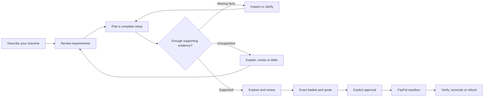
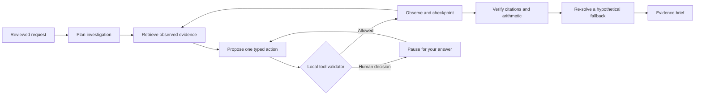

<div align="center">

# IntentCart

### Before you buy the parts, know whether the whole thing works.

Your workspace assistant—from an idea to a plan you can inspect.

[Run locally](#run-locally) · [File research](#read-your-own-spec-sheets) · [How it works](#from-a-request-to-a-reviewed-decision)

</div>

## A cart holds products. A plan makes them work together.

> “I have a laptop. I want two monitors, enough charging power and a setup within my budget. What do I actually need?”

The dock looks right. The monitors fit the budget. The cables are in the cart. But can the laptop drive both displays? Is a driver required? Does the power supply deliver enough charging power?

IntentCart starts with the outcome. Describe what you want, review a few details, and let the AI investigate. Watch the actual progress, answer a permission question when needed, and see the recommended parts together. Open the sources or the interactive 3D studio when you want more detail. Missing information stays visible. An impossible request gets an explanation. When availability changes, the planner looks for a repair that changes the fewest component slots.

Payment is a separate decision. A supported plan never grants permission to spend: an exact basket, current quote and explicit approval precede PayPal **sandbox** checkout.

## Explore the pieces together

The illustrated desk is interactive: drag to look around, select a component, or separate the parts to see how the workspace is arranged. The **Parts** menu offers the same inspection with a keyboard; **View** rotates, zooms and resets the camera. The supported result uses the exact part names from your reviewed plan. Shapes and spacing are illustrative, rather than measured product dimensions.

Three.js renders the scene on demand, while Anime.js 4.5 provides short spring transitions. There is no continuous idle render loop or model call behind the visual controls. Reduced-motion preferences are respected, and a static illustration plus text controls keep the request flow usable when graphics are unavailable. These are browser graphics, not a rented GPU or WebGPU deployment. React, R3F, Rapier and Rive are not dependencies of this plain-JavaScript interface.

## From a request to a reviewed decision



The application keeps these boundaries explicit:

- **Requirements before recommendations.** AI proposes settings for your review; the fields you approve remain authoritative.
- **Evidence before support.** Known, unknown and conflicting facts are distinct. Source dates, exact variants, prices and permissions matter.
- **Preferences within constraints.** Pairwise choices update a Bayesian estimate without weakening hard requirements.
- **Approval for one exact decision.** Changed plans invalidate old quotes. Payment retries preserve operation identities, and uncertain results require reconciliation.

## Run locally

**Requires Python 3.12.** No Node.js build, API key, paid service or rented GPU is needed for the local application.

```sh
git clone https://github.com/usmanmohammed2306/IntentCart.git
cd IntentCart
python3.12 -m venv .venv
source .venv/bin/activate
python -m pip install -r requirements.txt
python -m intentcart
```

Open **http://127.0.0.1:4000** for the guided AI assistant. Connect Astropods with an explicitly approved credit budget to use the model agent. The deterministic research baseline and `/missions` 3D planner remain runnable without keys. Local SQLite storage is created automatically in `var/`.

On Windows, create the environment with `py -3.12 -m venv .venv`, activate it with `.venv\Scripts\Activate.ps1`, then run the same install and start commands.

To check a running server:

```sh
curl http://127.0.0.1:4000/healthz
```

Expected response: `{"status":"ok","environment":"sandbox"}`.

## Explore the workspaces

| Address | Experience |
|---|---|
| `/missions` | Describe → Explore → Review. Inspect parts, orbit the 3D setup and repair fictional-catalog plans. |
| `/` or `/agent` | Start a checkpointed research workflow: investigate, verify, explore a fallback and download a cited brief. |
| `/workbench` | Review manufacturer records, exact variants, owned inventory, source expiry, all-in costs and preference history; export the decision. |
| `/research` | Explore saved finite-budget comparisons, CPU learning curves, ablations and preference diagnostics. |
| `/reliability` | Inspect separate decision claims, evidence-budget comparisons and recorded fake-provider failure traces. |
| `/learn` and `/lab` | Explore Bayesian pairwise learning and rehearse fictional budget, shipping or stock changes. |
| `/study` | Open the optional consent-based local pilot instrument. No conducted human study is claimed. |

The workbench preserves unsaved requirement edits in tab memory when another tab changes the task. Compare your edits with the latest saved values, restore only your changed fields, then explicitly review and apply them. Nothing is automatically resubmitted or saved to browser storage.

Before accepting a source replacement, compare its current and proposed values, units, URL and review date. Changed metadata is highlighted, and confirmation is bound to the displayed proposal and task revision. Refreshing, changing the proposal or editing its form clears that confirmation; acceptance never replaces a fresh inspection. You can withdraw a mistaken pending proposal without changing accepted evidence or preference answers. The exact proposal ID and task revision prevent an older tab from withdrawing a newer proposal.

The **Trade-off lens** compares two currently supported setups from the same revision: all-in price difference, exact component/quantity changes, estimated preference contributions and inspected source fields. Download a readable comparison without changing the task, selecting a basket or granting checkout approval. Refreshing or changing the choices clears the old comparison.

The evidence workspace uses curated manufacturer records and declared scenario assumptions. It cannot create checkout. Missions uses a separate fictional merchant catalog. Browser WebGL renders the locally served Three.js scene, with an illustrated fallback; the planning core runs on CPU.

## An agent that finishes the investigation

Open `/` or `/agent`. Write a request or choose a visual example, select **Let’s plan**, review the details, then choose **Find my setup**. The request, review, investigation and result appear one at a time. **Details** holds the source records and advanced controls. Screen counts use illustrated buttons; results lead with part pictures and everyday labels. The workflow decides which missing detail to inspect next, pauses for your software permission, verifies the supported result and explores what changes if the selected dock becomes unavailable. With driver permission enabled, it also checks the alternative without that permission. A concise brief keeps the recommendation, supporting observations and unresolved questions together.



**AI is the primary engine.** Astropods first generates a bounded investigation plan, then proposes the next action using the reviewed task, recent observations and hybrid retrieval from visible/inspected evidence. The server validates every proposal. At completion, the model selects and orders already verified claim IDs for the brief; it cannot invent report facts. The deterministic research baseline remains explicitly separate under **Details → Advanced controls**. Local verification shares the existing finite compatibility evaluator, so it is not an independent hardware oracle or source-truth check.

**Progress survives a refresh.** SQLite stores the current workflow and a hash-linked journal. Run identity, task fingerprint, revision, source identity and review date reject stale work. Each explicit request performs at most four local transitions or one model request. The primary visual-planner interpreter also uses real model inference and resets software permission before human review. Closing the page starts no background worker. Cancellation stops future steps; an already dispatched response cannot restore a cancelled or changed run. Lost or rejected model replies retain their durable call/cost reservation and trigger no automatic retry.

**Inspectable output.** The brief includes supported claims with exact source IDs, structural checks, counterfactuals and limitations. Markdown and JSON exports omit the free-text request and raw journal, but still contain product/evidence details: review them before sharing. Retrieval combines BM25 with a pinned local Hugging Face MiniLM encoder when configured. PyTorch runs masked mean pooling and normalized 384-dimensional embeddings on CPU; reciprocal-rank fusion combines the ranks. Only already visible or inspected, current sources enter retrieval. Without the reviewed local encoder, the response explicitly reports lexical fallback. Neither cosine similarity nor rank is factual confidence; this does not browse the open web. An eligible fictional-catalog brief can seed the 3D planner’s requirement form for fresh review; this resets software permission and transfers no evidence, quote or approval. All budgets remain active, and neither engine grants scenario confirmation, software permission or payment approval.

## Engineering behind the experience

| Layer | Actual implementation |
| --- | --- |
| Application | Python 3.12, FastAPI, strict Pydantic schemas, HTTPX |
| Model inference | OpenAI Python SDK pointed at the optional Astropods gateway; no OpenAI account required |
| Orchestration | LangGraph routes one guarded transition at a time; SQLite transactions persist run checkpoints, ownership and revisions |
| Hosted identity | Official Astropods auth SDK, signed and expiring platform claims, private access-list checks and account-bound sessions |
| Retrieval | BM25 + CPU PyTorch/Hugging Face Transformers; Sentence Transformers and Qdrant for owned file passages |
| File parsing | Docling, pypdf, LlamaIndex passage boundaries; bounded network-disabled parser process |
| Storage/search | SQLite durable state, source-bound JSON, exact private Qdrant vector search and a bounded embedding cache |
| Tools | Strict product search, evidence inspection, human questions and recommendation actions; separate read-only MCP snapshot server |
| Observability | OpenTelemetry SDK with an in-process 128-span buffer and owned-run export; no network exporter or prompt capture |
| Interface | Build-free browser JavaScript, responsive CSS, SVG illustrations and Three.js in the optional 3D studio |

The model proposes; server-side validation checks every action, citation, permission and price calculation. The SDK has **zero automatic retries**, disallows redirects and bounds decoded success/error bodies to 64 KiB. Call and cost reservations persist before dispatch and remain consumed after an uncertain or invalid response. LangGraph does not replace the SQLite transaction boundary. Hosted tracing, distributed training, fine-tuning, GPU serving and edge inference are not activated or claimed. The release uses one implementation for each implemented job; it does not claim every alternative framework in the ecosystem. Jev’s typed API was reviewed and protocol-tested privately, but no live TypeSafe key or approved provider allocation was supplied, so no Jev inference result is claimed.

### Local semantic retrieval

The explicit setup step downloads public encoder weights once; starting the application never downloads a model or starts a GPU job.

```sh
python scripts/setup_encoder.py --directory var/encoder
INTENTCART_EMBEDDING_DIR=var/encoder HF_HUB_OFFLINE=1 TRANSFORMERS_OFFLINE=1 python -m intentcart
```

The encoder is [sentence-transformers/all-MiniLM-L6-v2](https://huggingface.co/sentence-transformers/all-MiniLM-L6-v2), revision `173eb854beababc71d6c2962980f98ac8f7a975d`, licensed Apache-2.0. Setup saves provenance and file hashes; runtime validates them and uses local safetensors without remote model code. Weights stay outside Git. This is pretrained encoder inference, not training or a newly developed model. Field-level retrieval evaluations are separate from end-to-end recommendation quality.

### Read a brief through MCP

Download a completed research brief as JSON from **Details**, or **Save my plan** on the result, review its product/source content, then select that one artifact when starting the official MCP stdio server:

```sh
python -m intentcart.mcp_server --snapshot /absolute/path/intentcart-research.json
```

An MCP client can call `get_setup`, `verify_snapshot`, `get_claims`, `search_sources` and `get_fallbacks`. All five tools are read-only. There is no file-selection, model-dispatch, task-mutation or payment tool. The selected artifact is untrusted data. Citation consistency is not an authenticity signature, a freshness guarantee or a physical hardware test.

## Read your own spec sheets

Open **Details → Read a spec sheet**. Add a PDF with selectable text, Markdown or a text file. The server reads it with Docling and pypdf, splits passages with LlamaIndex, then searches them with local Sentence Transformers embeddings and exact Qdrant search. No hosted embedding service or vector account is needed.

Files are limited to 1.5 MB, eight PDF pages, 40,000 readable characters and five files per browser session. Original uploads are deleted after extraction; the owned extracted text is stored in SQLite. Images and external resources are not fetched. Scanned PDFs need a text layer; no OCR is claimed.

**Find passages** reads locally. **Ask AI** appears after you review the retrieved passages and explicitly agree to send the question and excerpts to Astropods. AI selects from those passages; the answer quotes the actual text with page references. It cannot invent a quotation or turn a file into verified compatibility evidence. Changing the question clears the reviewed context and sharing choice. Removing a file leaves the workstation plan and approvals untouched.

Every AI operation reserves its shared call/cost allowance before dispatch. Exact operation IDs prevent an HTTP retry from repeating the model call. A lost response can recover the recorded answer through a read-only status request. Invalid responses retain the reservation. File text is private to its owning browser session; it is not included in public logs, traces or source exports.

## Run the container

The image includes the pinned CPU encoder. Building it downloads public packages and weights; starting it performs no model download or automatic inference.

```sh
docker compose up --build
```

Open **http://127.0.0.1:4000**. The default container has zero external-call and inference ceilings. Configure a deliberately approved model allocation privately to enable real inference. SQLite uses the stable named `intentcart-local-data` volume. The app runs as a non-root user, with a read-only image filesystem and a bounded temporary directory.

## Sponsor-hosted frontend

`astropods.yml` packages this same application as a custom Astropods frontend, with its managed gateway and persistent `/data` storage. The dedicated `Dockerfile.astropods` serves port80 as an unprivileged user; the default `Dockerfile` keeps its original high port. The explicit file also supports CLI versions that ignore multi-stage build targets. Check the account's actual eligibility and deploy-form estimate before provisioning. Astropods documents free compute for its oldest running agent; model usage and any separately billed storage still need limits. Render credits are an alternative subject to its payment-method requirements; Azure is the fallback.

The hosted profile uses the official `astropods-adapter-core` authorization SDK with signed, expiring ALB identity headers and the deployment's private access list. A bare user-ID header is insufficient. Missing deployment identity, a development identity, an anonymous outage fallback, invalid signature, access denial and authorization outage all fail closed. Browser sessions bind to the verified signed-in subject; changing accounts starts a separate owned session. Authorization decisions may remain cached for30 seconds.

Set the declared production origin to the exact assigned HTTPS hostname. Deployment requires an explicit fixed allocation ID, reviewed starting usage totals and one-time installation approval. `intentcart.installation` seeds a new volume with those totals; restarts retain later usage and reject changed allocation declarations, counters below the declared migration baseline, missing markers or a missing database on previously marked storage. An older valid backup can still omit later usage; reconcile that usage before any manual restore. Remove `INTENTCART_FIRST_INSTALL_APPROVED` after the initial installation and verify a restart before inviting anyone. This is a single-instance migration mechanism, not an automatic backup restoration or budget renewal service.

```sh
ast spec validate
ast blueprint push intentcart --visibility private
ast blueprint deploy intentcart --vars-file /private/approved-launch.env --dry-run
```

Only deploy after reviewing the resolved configuration, access list, compute/storage estimate and persistent-volume settings. Keep credentials and operator migration files outside Git. A build, schema validation or dry-run alone does not confirm a live deployment.

## Public launch profiles

| Profile | Intended behavior |
| --- | --- |
| `local` | Private laptop development and explicitly bounded manual inference |
| `public-preview` | Read-only, no provider keys and zero external ceilings; suitable for the included free Render preview blueprint |
| `production` | Invited HTTPS launch with a private access password or verified Astropods authorization, confirmed durable storage and a separately approved model allocation |

The production profile refuses startup when those prerequisites are missing. `INTENTCART_AUTH=astropods` selects the signed platform identity flow and requires its injected deployment token; the default `basic` policy uses the private launch password. It uses one process and one instance; it is not a horizontally distributed payment service. `GET /readyz` checks configuration and storage access. Progress streams contain owned checkpoints, never advance the agent, and close automatically; they are not token-generation or idle model jobs. API and HTML responses are private/non-cacheable. Only versioned public static assets receive immutable caching headers; this is not distributed edge inference or an AI-CDN deployment.

For the standalone Caddy deployment, before exposing the instance:

1. Put private settings outside Git. Set `PUBLIC_URL` to the exact HTTPS origin, `COOKIE_SECURE=true`, `INTENTCART_MODE=production`, a private `INTENTCART_ACCESS_PASSWORD` of at least 32 bytes and `INTENTCART_STORAGE_ACK=durable`.
2. Configure the Astropods endpoint, key, reviewed rates, credit-only confirmation and **separate** positive call/cost ceilings. Set `INTENTCART_PUBLIC_INFERENCE_APPROVED=true` only for the allocation approved for this public launch. Do not copy or renew another session's allowance.
3. Mount a durable local block-backed volume, then explicitly run `python -m intentcart.release --init-storage` on that volume. This creates an installation marker without resetting receipts or counters.
4. Use the immutable audited application image in `compose.production.yaml`, supply `APP_DOMAIN` and the private environment-file path, then start the app behind the included Caddy HTTPS proxy. The application trusts only that proxy's fixed private address. Username is `intentcart`; the password is the private value from step 1.

The [official hackathon Render page](https://paypalaihackathon.devpost.com/details/render) links the [$50 organizer claim flow](https://credits-portal-mmdm.onrender.com/claim/paypal-ai-hackathon). Redeem it into the intended workspace and verify the balance. Free Render services have ephemeral storage and are represented here by the read-only preview. A durable AI launch needs a paid compute instance and persistent disk; verify credit-only eligibility and payment-method requirements before creating either. Do not add a card or create cash exposure just to consume a grant. The Azure fallback in `deploy/azure/main.bicep` provisions one CPU-only ARM Linux host with a local disk and one administrator `/32` SSH rule. The template does not provision a GPU, Kubernetes, paid inference or a registry. Compile and review it before deploying:

```sh
az bicep build --file deploy/azure/main.bicep
az deployment group what-if --resource-group YOUR_GROUP --template-file deploy/azure/main.bicep \
  --parameters location=westus2 sshPublicKey=YOUR_PUBLIC_KEY adminIpv4=YOUR_IP dnsLabel=YOUR_AVAILABLE_LABEL
```

Check the actual subscription's region policy, CPU quota, credit balance and spending limit first. The supported host size is configurable because account eligibility varies. Use a Linux/ARM64 application image with the default ARM host. The template prepares infrastructure; source delivery, private settings, volume initialization, TLS and a successful external smoke check are required before calling the site live. No subscription upgrade or paid plan is automatically selected.

For an explicit private backup, while preserving the live allowance ledger:

```sh
python -m intentcart.backup --output /private/backups/intentcart.sqlite3
```

Backups can contain private sessions, uploaded text and sandbox records. Keep them out of Git. The command creates a new mode-600 backup and verifies integrity and the usage counters. It does not upload, schedule or automatically restore old counters. Stop the service and reconcile any later usage before a restore.

## Optional configuration

The application reads a private `.env` from the repository root. It is ignored by Git. The defaults run locally with external inference and discovery disabled:

```dotenv
PUBLIC_URL=http://127.0.0.1:4000
DATABASE_PATH=var/intentcart.sqlite3
EXTERNAL_CALL_LIMIT=0
ASTRO_BUDGET_MICROUSD=0
```

If you change the port, set `PORT` in the shell before starting and make `PUBLIC_URL` match the exact browser origin. Keep the server bound to localhost for local use.

**PayPal sandbox:** create a sandbox REST application in the [PayPal Developer Dashboard](https://developer.paypal.com/dashboard/applications/sandbox), set `PAYPAL_CLIENT_ID` and `PAYPAL_CLIENT_SECRET` privately, restart the server and use a separate Personal sandbox buyer. Review and approve the exact quote before opening checkout. No real funds or goods are involved. After an uncertain capture, reconcile the existing order before retrying.

**Optional hosted inference:** the Astropods adapter requires `ASTRO_GATEWAY_URL`, `ASTRO_GATEWAY_API_KEY`, `MODEL_DEFAULT`, explicitly reviewed input/output rates, `ASTRO_CREDIT_ONLY_CONFIRMED=true`, and positive call and cost ceilings. Costs are configured in micro-USD; the rate variables are `ASTRO_INPUT_MICROUSD_PER_MILLION` and `ASTRO_OUTPUT_MICROUSD_PER_MILLION`. Keep ceilings at zero unless you deliberately authorize usage. The main workspace selects real inference. A missing connection or exhausted budget is shown explicitly; it is never presented as a working model. Deterministic policies remain available as named research baselines.

**Optional discovery:** `CHANNEL3_API_KEY` and an explicitly positive `EXTERNAL_CALL_LIMIT` enable separate product discovery. Discovery listings do not authorize checkout or establish compatibility.

## Inside the runnable source

```text
intentcart/
  app.py, *_routes.py         HTTP routes, session ownership and persisted state
  missions.py                Finite planning, investigation and minimal-change repair
  agent.py, workbench.py      Bounded actions and human evidence review
  orchestrator.py            Strict research transitions, verification and briefs
  workflow.py                LangGraph routing over those guarded transitions
  semantic.py                Offline PyTorch/Transformers evidence retrieval
  documents.py               Bounded, network-disabled file parsing
  document_routes.py         Owned file lookup, consent and idempotent AI answers
  vector_search.py            LlamaIndex / Sentence Transformers / local Qdrant
  model_usage.py              Shared durable model reservations
  production.py, release.py   Fail-closed launch configuration and readiness
  progress.py                Bounded owned server-sent checkpoints
  backup.py                  Explicit private SQLite backup verification
  observability.py           Bounded local OpenTelemetry spans
  sdk_transport.py           Bounded OpenAI-compatible HTTPX transport
  mcp_server.py              Read-only selected-brief MCP tools
  evidence_catalog.py        Curated sources and exact product variants
  learning.py                Bayesian preference learning
  workspace_preferences.py   Preferences over supported configurations
  acquisition.py             Finite evidence-acquisition reference
  finite_budget.py            CPU budget and learning diagnostics
  validity.py, research.py    Decision claims and source-checked saved results
  replay.py                  Local failure reproduction with a fake provider
  paypal.py, gateway.py      Optional bounded external transports
  data/                      Catalogs, settings and results used by the interface
  web/                       HTML, CSS, JavaScript, illustrations and Three.js
scripts/                     Saved-view evaluators and explicit encoder setup
docs/protocols/              Two machine-readable inputs for those views
requirements.txt             Pinned runtime dependencies
```

The research views check saved results against their source hashes. Their supporting scripts and JSON protocols are retained so those checks remain usable. To regenerate a report locally, for example:

```sh
python scripts/evaluate_missions.py --output /tmp/intentcart-missions.json
```

## Scope and limits

IntentCart is a **single-instance sandbox application** built for the 2026 PayPal AI Hackathon. Compatibility means support under the represented finite rules and available evidence; it is not physical hardware certification or a live retailer guarantee. Saved synthetic experiments, CPU learning diagnostics and fake-provider replays are distinct from human studies and live transactions. Negative learning results remain visible in the application.

The local planning experience works without external services. Actual inference, discovery and sandbox payments require your own deliberate configuration. The project does not include account authentication, distributed settlement, live inventory, fulfillment or production security certification. Source fingerprints detect content changes; they are not authenticity signatures.

Released under the [MIT License](LICENSE). Bundled Three.js retains its [upstream notice](intentcart/web/vendor/THREE_LICENSE.md).

## Decision Studio

Open **Planning workbench → Decision Studio** after the evidence agent has returned supported configurations. Explore the decision without changing it: all analyses run locally in the browser, over at most the twelve returned options in the loaded revision. They do not search the full catalog, fetch sources, predict actual prices or grant checkout authority. Refresh the task to obtain a newer revision; results are discarded when the loaded task changes.

<details>
<summary>Available planning tools</summary>

- **Budget coverage staircase** — See which returned setups remain affordable at each budget step; no plan is recomputed.
- **Tax and shipping allowance** — Find the maximum combined extra costs each supported basket can absorb within your hypothetical budget.
- **Component spend exposure** — Identify which component categories account for the largest share of one complete basket.
- **Single-product outage recovery** — Find the least disruptive returned fallback when one exact product is unavailable.
- **Correlated stock-out stress** — Remove up to four products together and inspect surviving complete baskets.
- **Dock dependency resilience matrix** — Stress every represented dock independently and see the fallback cost for your starting setup.
- **Diversified three-setup shortlist** — Choose three returned options that maximize their minimum component-slot distance, then minimize combined price.
- **Least-change replacement graph** — Map the closest supported alternatives by changed component slots, with exact transition cost.
- **Least-disruption budget ladder** — For each affordable price breakpoint, find the option with the fewest changed slots relative to your current choice.
- **Per-product price-rise tolerance** — Calculate how much each product unit price can rise before every containing returned basket exceeds your budget.
- **Uniform hardware inflation stress** — Apply a user-declared percentage price increase to component subtotals while keeping saved tax/shipping fixed.
- **Exact-product price shock** — Change one component unit price hypothetically, respecting the quantity in each supported basket.
- **Tax and shipping scenario estimator** — Replace saved extras with a declared tax rate on hardware and a fixed shipping amount.
- **Declared operating-cost horizon** — Compare purchase plus explicitly assumed electricity and maintenance costs over a chosen horizon; no device consumption is inferred.
- **Cost per productive session** — Translate one-time planning costs into a stated number of work sessions without implying financing or resale value.
- **Worst-case price interval screen** — Screen setups against a declared component-price uncertainty band; saved extras remain fixed.
- **Price-scenario minimax regret** — Find the smallest worst-case excess cost across baseline, hardware-inflation and one-product-shock scenarios among returned options.
- **Cost and model-trade-off Pareto frontier** — Identify returned setups dominated on total price, changed slots and the three estimated non-price contributions.
- **Exact-component shortlist locks** — Filter supported alternatives while keeping up to four explicitly selected components.
- **Preference-contribution reweighting sandbox** — Explore user-supplied multipliers over the current model contribution estimates; no learned preference is changed.
- **Preference sensitivity sweep** — Count which options lead on a fixed 35-profile multiplier grid, retaining exact ties rather than inventing probabilities.
- **Preference cycle audit** — Detect directed cycles in the last 48 retained explicit A/B answers, with ties and skips kept separate.
- **Distinctive comparison pair finder** — Surface supported pairs absent from the last 48 retained comparisons with large differences in model-contribution vectors.
- **Source review expiry forecast** — Forecast review deadlines from observed dates and the declared review interval, separating undated/fictional fields.
- **Observed-source dependency blast radius** — Map each inspected product field to returned baskets containing that exact product.
- **Source origin concentration audit** — Group observed fields by cited URL origin and evidence kind; do not confuse repeated fields with independent sources.
- **Observed-value contradiction audit** — Find distinct values observed for the same exact product and field without resolving the contradiction automatically.
- **Evidence review priority queue** — Order inspected fields by overdue/unknown age and number of exposed returned setups.
- **Portable private-data-minimized decision snapshot** — Export supported plans, product declarations and observed fields without query text, sessions or raw event history.
- **Earlier-versus-current decision snapshot diff** — Paste an exported studio snapshot to compare prices, available setup IDs, observed values and source identities without importing authority.

</details>

Each result can be downloaded as JSON. Review product and source content before sharing. Price scenarios use integer cents with explicit rounding; operating costs use your declared assumptions. Preference contributions describe a finite model, not measured hardware performance or personal satisfaction. None of these tools updates the basket, requirements, evidence, preference history or payment approval.

## Contingency and reproducibility tools

Decision Studio now supports deeper local investigation over the same returned options. Portfolio costs count the maximum units needed to build one alternative at a time; they exclude tax/shipping. Declared outage probabilities are hypothetical independent-product assumptions, with shared components retained. No purchases, source fetches, model requests or task mutations occur.

<details>
<summary>Additional capabilities</summary>

- **Searchable tool navigator** — Find analyses by name, group or description, with an explicit no-match state.
- **Reproducible analysis receipts** — Export whitelisted parameters and source/revision identities; pasted documents are omitted and marked non-replayable.
- **Saved-analysis replay verifier** — Recompute a non-import analysis on the same loaded revision and identify edited or incompatible receipts.
- **Minimum contingency portfolio** — Exhaustively find the smallest set of returned options covering every representable single-product outage, breaking ties by shared-inventory cost.
- **Budgeted maximum outage coverage** — Search all returned-option subsets for the most single-product outages covered within a hypothetical shared-hardware budget.
- **Minimum component cut sets** — Enumerate the smallest sets of up to three product failures that eliminate every returned supported option.
- **Shared spare-kit bill of materials** — Combine chosen returned setups using maximum component quantities, avoiding double-counting shared parts.
- **Declared spare inventory reuse** — Calculate additional exact-product quantities for each returned setup from a declared inventory without assuming ownership.
- **Backup-pair shared-failure matrix** — Compare every returned pair by common failure points and shared inventory cost rather than assuming independent backups.
- **Marginal spare-product unlocks** — Find how many returned alternatives one additional unit of each product unlocks from a starting setup.
- **Contingency coverage cost frontier** — Compute exact shared-inventory cost breakpoints where the maximum number of covered single-product outages increases.
- **Shared-component availability model** — Use exact inclusion-exclusion to calculate alternative-setup availability under a declared independent per-product outage probability.
- **Component outage importance** — Compare portfolio availability conditional on each exact component working or failing, retaining shared-part dependence.
- **Outage-assumption sensitivity curve** — Evaluate a chosen portfolio at five points between declared common product-failure probabilities.
- **Incremental trade-off exchange rates** — Relate an exact price change between two returned options to each estimated non-price contribution change.
- **Minimum preference transfer to tie the leader** — Find the smallest normalized weight mass moved from uniform weights that lets each rival tie the current uniform-score leader.
- **Contribution-interval robust shortlist** — Screen uniform-score rankings under a declared independent interval around each estimated contribution.
- **Tie-aware rank consensus** — Aggregate four single-contribution rankings with average tied ranks and expose the per-dimension ranks.
- **Lexicographic priority ordering** — Order returned setups by an explicit sequence of priorities, avoiding arbitrary numerical trade-off weights.
- **Price versus model-value envelope** — Find the upper concave price/value envelope and its diminishing marginal contribution gains.
- **Repeated-comparison consistency audit** — Group the last 48 explicit pairwise answers, retaining orientation, ties, skips and opposing answers.
- **Preference comparison coverage graph** — Identify disconnected groups and unanswered setup connections within the last 48 retained comparisons.
- **Minimum observed-field explanation cover** — Find a smallest set of observed fields covering every represented check label in the loaded source links.
- **Observed evidence-to-check matrix** — Expose check labels with and without product-matched inspected source links for every returned setup.
- **Canonical citation duplicate audit** — Find citations sharing a URL after removing fragments and sorting query parameters, while retaining distinct source IDs.
- **Time-budgeted evidence review plan** — Choose observed fields under a declared review-time budget using exact knapsack optimization of summed setup exposures.
- **Cross-snapshot changed-source impact** — Compare observed values and cite current returned setups containing products whose prior evidence changed.
- **Cross-snapshot migration parts list** — Calculate retained, additional and surplus exact-product units between one earlier setup and a current supported setup.
- **Analysis receipt difference review** — Compare assumptions and changed result cells from two downloaded analyses of the same tool without executing imported instructions.
- **Readable analysis handoff export** — Download a plain-language Markdown brief with assumptions, source identities, table and limitations; private task query and pasted documents stay excluded.

</details>

Exact subset searches are bounded by twelve returned setups. Probability portfolios are capped at eight setups; imported JSON is capped at 120,000 characters. These diagnostics do not establish full-catalog optimality, measured reliability, source truth, human utility or payment permission. Refresh explicitly for a newer task revision. Review exported structured product/source records before sharing.

### Correlated shared-cause outage scenarios

In **Decision Studio**, select **Correlated shared-cause outage scenarios**. Choose returned setup IDs (blank uses the first two), then declare up to six hypothetical causes. Each cause has a unique name, a probability in percent (0–100, at most two decimal places) and exact product IDs from the chosen setups:

```json
[{"name":"Shared shipment","failure_percent":10,"products":["exact-product-id"]}]
```

Replace the example ID with an ID in the setup legend. One cause may disable multiple products; products may appear in several causes. All cause combinations are enumerated (at most 64), with their probabilities, failed products and surviving setups. The result includes per-setup and portfolio availability under these assumptions. An empty array models no failures.

Causes are assumed mutually independent. Products are correlated through declared causes; unlisted products remain available, and no other failures are modeled. No supplier relationships, live stock, measured reliability or timing are inferred. Results do not change support, task state or payment approval. JSON and readable exports include cause names/IDs and assumptions; review before sharing. Pasted document text is omitted from receipt parameters, and this analysis is not receipt-replayable.
