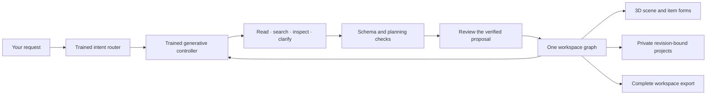

<div align="center">

# IntentCart

### From “will this work?” to a purchase you can explain.

**An AI workspace planner with a reviewed cart and PayPal Sandbox checkout. Keep what works, investigate what is missing, and approve every payment yourself.**

[Run locally](#run-locally) · [PayPal + AI](#from-ai-investigation-to-paypal-sandbox) · [The workspace](#your-space-your-way)

</div>

## A better starting point than another shopping cart

You have a laptop, a small table and a few things that already work. You might need one monitor. You might need none. Perhaps all that is missing is a cable.

IntentCart lets you build that situation first. Place independent objects in a visual workspace, enter measurements you trust, keep an area clear and see what is known—and what still needs checking. There is no compulsory dock, screen, table or purchase.

The product is a planning aid. Its purpose is to reduce avoidable purchases and overlooked constraints, not to promise that a drawing proves a setup will work. Customer demand and willingness to pay remain unvalidated.

## From AI investigation to PayPal Sandbox

Imagine you need a two-screen setup but already own one screen. Buying the cheapest dock alone can leave you without the right power supply or cable. **Shop** asks the trained local agent to investigate a complete cart, inspect missing catalog facts and check the exact budget and compatibility conditions before making a recommendation.

1. **Find a complete cart.** Sign in, open Shop and review the laptop, screen count, budget and explicit software choice. The controller chooses search, inspection, recommendation or deferral; it has no payment tool.
2. **See what you would get.** Preview the returned items as a new 3D draft. Earlier saved projects remain separate. Unknown dimensions stay unknown; the scene does not certify physical fit.
3. **Review the exact amount.** Request a quote bound to the agent run, catalog, source identity, revision and exact draft. Changed inputs or stale evidence require another review. A quote expires after fifteen minutes.
4. **Approve in PayPal Sandbox.** An unchecked human approval control precedes the PayPal buyer flow. The server creates an Orders v2 order, verifies the exact quote/reference/currency/amount, captures only the approved order and retains an owned payment record.
5. **Recover or refund.** Saved status reconciliation and full sandbox refund reuse durable operation identities. A lost response is checked before another attempt; a model cannot grant payment authority.

The bundled seller catalog and laptop profiles used by Shop are **fictional sandbox fixtures**. There are no real goods, shipping, tax charges or delivery promises. The default supported cart currently totals **$229.00 in sandbox funds** after source inspection; different reviewed settings can change it. Independent manual workspaces still allow zero screens, no desk and no purchase. Arbitrary imported objects are not silently converted into seller SKUs or payable baskets.


## Your space, your way

- **Start without an account.** Add laptops, desktops, screens, keyboards, mice, docks, cables, power adapters, webcams, audio, storage or a generic object. Each instance can be moved, rotated, renamed or removed independently.
- **Make it yours.** A Three.js scene uses procedural materials, lighting, shadows and original graphics. Drag an object, orbit the view, zoom, lock placement or undo an edit. Forms and an item list provide an alternative to canvas interaction.
- **Use real measurements.** Declare the surface, each object's overall in-use size and reserved areas. Dimension notes distinguish personal measurements, manufacturer sources and illustrative shapes. A model name alone never invents specifications or an exact replica.
- **Keep unknowns visible.** Footprint containment and overlap checks use rotated bounding rectangles. Missing measurements produce “Unknown.” This is not CAD, structural analysis, electrical certification or an ergonomic assessment.
- **Spend deliberately.** Separate owned equipment from proposed purchases. A zero budget is valid. Prices, currency, shipping and tax are explicit; missing charges never silently become a complete all-in price. A buy-nothing plan has no new purchase cost.
- **Remember the whole request.** Requirements remain in a ledger with open, met, unmet or specialist-needed outcomes. Resolution records the user's reason; it is not an independent verification.
- **Keep projects separate.** Accounts save up to twenty private named workspaces with revision conflict protection. Export/import includes the complete workspace, measurements, connections and requirement ledger. Importing never restores account permissions, payments or AI budgets.

Guest drafts stay in browser-session storage, including across sign-in. They are never automatically merged over an existing saved project. Export a backup before closing the browser session, clearing its storage or switching devices.

### Simple controls

| Interaction | Action |
|---|---|
| Drag an item | Move it on the horizontal planning plane |
| Empty-space drag / Look | Orbit the camera |
| Scroll / + / − | Zoom |
| W / R / O | Move / rotate / look mode |
| Arrow keys on the focused canvas | Move selected item by 10 mm, or rotate in Rotate mode |
| Escape during a drag | Cancel the uncommitted placement |
| Items | Select and edit an object without aiming at the scene |

Rendering runs on demand, with no idle animation loop. Reduced-motion preferences are respected. If WebGL is unavailable, ordinary item and placement forms remain available. Shapes are conceptual, not photorealistic product scans.

## A trained agent with tools and boundaries

Sign in to ask for a change such as **“Add two monitors,” “I want no monitors,” “Move the laptop left,” “My desk is 90 by 50 cm,”** or **“My budget is zero dollars.”**

The trained router handles a single edit. For a larger request, **Plan** opens a bounded, durable agent workflow: search exact-device candidates, inspect recorded facts, compare proposed quantities and arrangements, verify declared goals, and return a proposal for your review. Explicit counts, negation, units, budget and software denial compile into visible typed conditions. Unrepresented wording remains a question, so this is not a claim of unrestricted language understanding.

**Research an exact device.** Select an item and choose **Find exact model**. The bundled library contains ten reviewed variants/configurations, not a universal catalog. Confirm the year, revision and operating state before linking it. Closed-laptop dimensions never substitute for an unknown open-lid footprint. You can extend the library through reviewed manufacturer pages, a locally parsed specification PDF/text file, or a bounded inventory import. Every accepted fact retains a source quotation/date and a content fingerprint. These are user-reviewed snapshots, not independent certification.

With explicit consent, a planning run can read up to two supplied official HTTPS specification pages. The allowlisted manufacturer reader checks every redirect and DNS destination, pins public connections, limits bytes/time and executes no page scripts. Only the URLs are sent; no account, workspace or private document goes to a model service. Unavailable pages and rate limits remain failures. Retrieved instructions cannot approve software, spending or accounts; extracted facts require review.

**Verify the whole declared plan.** Tools cover concave usable-surface outlines, blocked/access areas, rotated footprints, resource-counted video cables/ports, dated landed costs and declared exchange rates, closed-box packing, weight, reach and clearance. Save distinct work/packed/shared states, link projects to your own client records and build per-space procurement estimates with explicit inventory counts. A prototype owned once is not multiplied into classroom stock. Unknown load, operating-system, bandwidth, electrical, medical, acoustic, comfort and delivery facts remain explicit.

Runs have at most 24 reserved model steps, durable checkpoints, cancellation and explicit recovery. A model action with unmet prerequisites pauses; no deterministic policy silently replaces it. Plans are proposals: review exact variants, changes and caveats before applying. Source/day/design/project changes invalidate old results. Three-way conflict review preserves concurrent human edits. Project-only backups open as new drafts and never roll back account access, later saved work or usage counters. The public workspace shell and manual import/export can work offline after a successful cached visit; the server-based local AI needs the installation online and its model installed.

The model is required for AI actions. Missing or invalid artifacts produce an error; there is no silent baseline or paid-provider fallback. Guest manual editing is intentionally available without AI or an account.



### Actual training, distinct evaluations

The generative adapter specializes **Qwen/Qwen3-0.6B**, pinned to revision `c1899de289a04d12100db370d81485cdf75e47ca`. Completion-only PEFT LoRA trains **1,146,880 parameters**, rank 8 on query/value projections. The initial adapter ran **360 optimizer steps** on a free Colab **v5e-1 TPU**, using native TorchTPU/PyTorch, with **915 unique authored synthetic training examples**. Development selection used 289 separate examples; its original frozen 290-example evaluation reported:

| Original contract, bfloat16 evaluation | Exact matches |
|---|---:|
| Scene commands | 47 / 103 |
| Requirement requests | 128 / 128 |
| Finite-policy choices | 59 / 59 |

These numbers do not qualify the new workspace contract, current CPU precision, general reasoning or human usefulness. The unadapted base's zero exact-format matches were not zero semantic understanding. Failed/inconclusive CPU trials and the first TPU trial are retained in private development evidence.

The current adapter continues that checkpoint with actual **local Apple MPS float32 training**, using TRL completion-only supervised fine-tuning and PEFT. It completed **128 optimizer steps / 512 example presentations** from a **704-example training partition**—about 0.73 epoch, not a claim that every row was presented. Persona partitions were fixed before training; 52 development and 107 test examples stayed out of the optimizer. In a paired, uncached CPU Q8 exact-policy diagnostic, the continuation matched **105/107** test persona/context prompts versus **58/107** for the earlier adapter; both matched **59/59** original permission-policy targets. Two Q8 errors and the float32/quantization difference remain failures. Of the 107 test prompts, **103 share an exact observed finite state with training** (28 of the 32 distinct test states), despite different persona/context text. This is a related prompt-format/policy diagnostic, not unseen-state generalization, independent reasoning or human-quality evidence. The larger generated journey corpus was not all used as training data.

Current serving uses the merged adapter in **Q8_0 GGUF through llama.cpp**, CPU-only with zero GPU layers. Public base weights are not committed; the explicit setup verifies pinned base, adapter, converter and output checksums.

The additional small **PyTorch-trained multi-head intent classifier** uses hashed word/bigram features and runs through NumPy at inference. Its reproducible trainer, authored dataset partitions, weights and manifest are included. It was refined using development failures. Its random utterance partitions share templates, so their accuracy is a narrow template diagnostic—not independent generalization or a research benchmark. The fifty product scenarios were not a training dataset.

No foundation-model pretraining, RL, human-feedback learning or distributed training is claimed. Both models remain bounded and imperfect; controls and review are part of the product.

### Tools and their roles

| Tool | What it does here |
|---|---|
| PayPal Orders v2 and JavaScript SDK | Sandbox buyer approval, exact-amount order creation/capture, saved status reconciliation and full refunds |
| Qwen3-0.6B, PyTorch, Transformers, PEFT and TRL | Actual supervised training and bounded local generative tool selection; the separate trained router handles supported scene edits |
| llama.cpp | Offline CPU serving of the merged Q8 model; no rented accelerator or provider request is required |
| FastAPI, Pydantic and SQLite | Strict tool/API contracts, private accounts/projects, durable checkpoints, revisions and payment-operation identities |
| Three.js and Anime.js | Interactive procedural workspace graphics and transitions; graphics do not establish physical compatibility |
| Astropods | Earlier external-model research integration and sponsor-native hosting; the default local trained-agent flow does not spend its credits |

The earlier evidence-research workspace also contains LangGraph orchestration, an OpenAI-compatible SDK transport, local document parsing/retrieval and read-only MCP tools. Those capabilities are separate from the local trained shopping controller; listing them does not mean every action invokes every framework.

## Run locally

Use **Python 3.12**, a modern browser and a machine with sufficient free RAM/disk for installation and CPU inference. Initial setup downloads roughly 1.5 GB of public base files and builds the serving artifact; merging temporarily needs more memory than inference. A working C/C++ toolchain is needed when pip builds llama.cpp. The installer tests macOS linking and, if necessary, selects a compatible already installed SDK for its own subprocess; it never changes system settings. No paid API key, rented GPU, subscription or cloud account is required.

```sh
python3.12 -m venv .venv
source .venv/bin/activate
python scripts/install_runtime.py
python scripts/setup_trained_model.py
EXTERNAL_CALL_LIMIT=0 INTENTCART_AUTH=accounts python -m intentcart
```

Open **http://127.0.0.1:4000/agent**. Start building immediately; sign in to save or use the local AI. Create your own password and keep the recovery key private. SQLite data lives in `var/` unless `DATABASE_PATH` is configured. Run one application worker for this single-instance deployment.

The legacy document/research tools also require the optional offline retrieval encoder:

```sh
python scripts/setup_encoder.py --directory var/encoder
INTENTCART_EMBEDDING_DIR=var/encoder EXTERNAL_CALL_LIMIT=0 INTENTCART_AUTH=accounts python -m intentcart
```

On Windows, create the environment with `py -3.12 -m venv .venv`, activate `.venv\Scripts\Activate.ps1` and use PowerShell environment variables before `python -m intentcart`. CPU serving is the default; the new workspace proposal path is qualified on CPU. GPU acceleration is not required.

Check the server with `curl http://127.0.0.1:4000/healthz`. Local operation has no inference-provider fee. Hosting, electricity, downloads and third-party services have their own conditions; there is no automatic sponsor-credit renewal or card-funded fallback.

### Connect the free PayPal sandbox

Create a **sandbox REST app** in the [PayPal developer dashboard](https://developer.paypal.com/dashboard/applications/sandbox). Keep its client secret on your server. Configure `PAYPAL_CLIENT_ID` and `PAYPAL_CLIENT_SECRET` as private environment variables, then restart the app. Never commit them or paste them into the browser console. The server uses the sandbox API endpoint; live payments are not supported. Use a separate sandbox personal buyer account to approve the purchase. Planning works without these credentials, but payment controls explain that checkout is unavailable rather than simulating a payment.

`EXTERNAL_CALL_LIMIT=0` blocks sponsor-model usage; it is **not** a PayPal sandbox request counter. PayPal calls happen only through explicit human checkout, saved-status or refund actions. Setup downloads and local CPU inference do not spend sponsor inference credit. No real card, paid model key or cloud deployment is required to run the local prototype.

## Additional planning workspaces

The default workspace is independent of the earlier finite-catalog experiments. Existing saved accounts, evidence tasks and sandbox history are preserved.

| Address | Purpose |
|---|---|
| `/agent` or `/` | Independent objects, measured space, requirements and private projects |
| `/investigate` | Earlier checkpointed evidence workflow for its explicitly supported catalog |
| `/workbench` | Manufacturer records, source replacements, declared inventory, costs and preferences |
| `/research` | Authored finite-budget comparisons and ablations |
| `/missions` | Fictional-catalog compatibility planning and separately gated PayPal sandbox checkout |
| `/reliability` | Source-bound reports and fake-provider failure/recovery traces |
| `/account`, `/customers` | Account security and a private customer pipeline |

Connection research does not automatically certify the measured workspace. Historical sponsor-model and PayPal sandbox outcomes remain distinct from fake-provider diagnostics. Sponsor inference is inactive at a zero call limit; separately configured PayPal sandbox actions require human approval. No real-money payment is supported by the agent's tools. Astropods has supplied historical hosted inference and application hosting; using every optional sponsor is not a requirement and unused services are not claimed as integrations.

## What the checks establish

The local October 25 workspace acceptance run executes all fifty authored product scenarios as **bounded schema, planning, persistence and authority checks**. It keeps unresolved goals and specialist handoffs separate from task success. It does **not** establish that all fifty original real-world goals were achieved. No genuine human pilot, independent reproduction, measured adoption or willingness to pay is claimed.

Current checks cover guest/member flows, item independence, zero-screen/no-desk/no-purchase cases, declared costs, rotated footprint geometry, browser/server parity, private projects, stale revisions, export and actual local-model proposals. Exact device identification, trustworthy specification acquisition, real delivery/availability, clinical/industrial suitability, structural safety and enterprise procurement are not solved by a successful JSON check.

### October 25 qualification

| Check | Observed result | Scope |
|---|---:|---|
| Composed planning API journeys | 100,000 / 100,000 passed | 100 fictional accounts, 1,000 material signatures each; exact frozen planner core |
| Persona Chrome journeys | 100 / 100 passed | Actual in-process local CPU model; separate from the API run |
| Selected application regressions | 216 passed | Current workspace, accounts and commerce contracts |
| Checkout browser checks | 14 full-flow + 14 focused checks passed | Actual local model; explicitly fake payment provider for automated checkout |
| Clean local setup | Passed | Fresh Python 3.12 macOS environment and exact CPU model reconstruction |
| Real PayPal Sandbox | $229 captured and fully refunded | Separate approved test, ten server API calls; no real money |

The API corpus composes 28 mechanisms and eight recovery operations; it is not 100,000 independent natural-language tasks, uncached model generations or browser sessions. Identical complete model states may reuse an audited decision while every episode reruns its tools and verifiers. The separately curated subset contains 60 complete runtime policy states (43 train, 7 development, 10 test); persona or story changes do not inflate that count. Independent functional episodes reset fixture rates/history, so this is not load testing. The current checkout addition has its own qualification; the larger run covers the byte-identical bound planner core. All 1,004 earlier failed API attempts and browser failure records are retained alongside successful reruns. The full synthetic dataset and private test evidence are stored outside this minimal runtime repository; no fictional account credentials are published. These results do not establish human utility or general model competence.

## Project structure

```text
intentcart/
  workspace.py                 # Strict graph, footprint/cost checks, private project API
  workspace_agent.py           # Trained controller, tools and reviewed proposals
  workspace_intent.py          # Required hash-bound trained intent router
  trained_agent.py             # Required pinned local LoRA serving
  commerce.py                  # Trained shopping workflow and exact sandbox quote binding
  paypal.py                    # PayPal Sandbox Orders v2 and refunds
  accounts.py                  # Accounts, CSRF, ownership and customer records
  web/workspace*               # Visual editor, conceptual 3D scene, shared browser checks
  web/commerce-ui.js           # Human cart review, buyer approval and saved payments
  data/workspace-router/       # Router artifact and provenance
  data/trained-agent/          # LoRA artifact, licenses and serving manifest
training/                      # Authored data and reproducible training/evaluation recipes
scripts/                       # Required setup and source-bound report generators
```

## Licenses

Project source is [MIT licensed](LICENSE). Three.js and Anime.js retain their bundled notices in `intentcart/web/vendor/`. The Qwen-derived adapter/base carry their Apache-2.0 notices under `intentcart/data/trained-agent/`; llama.cpp notices are retained there too. Product names and linked specifications identify sources and do not imply endorsement. Procedural scene graphics are original; no third-party music or product scans are bundled.
