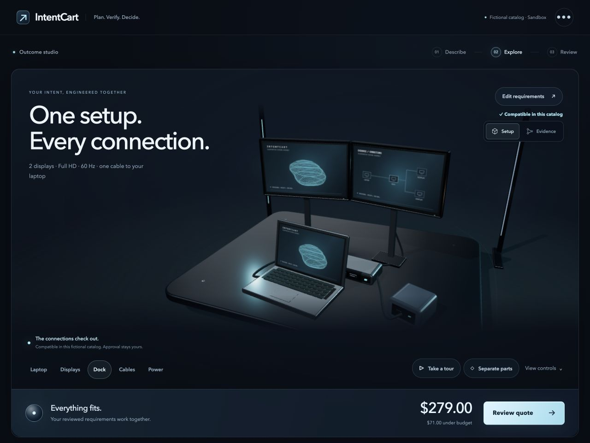
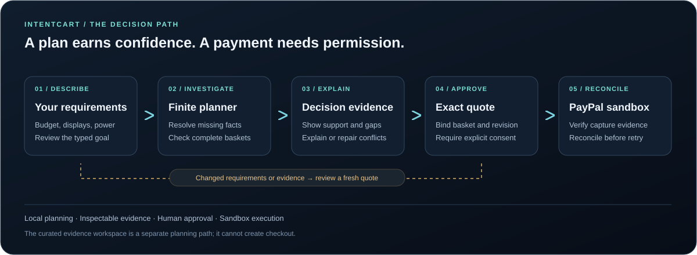
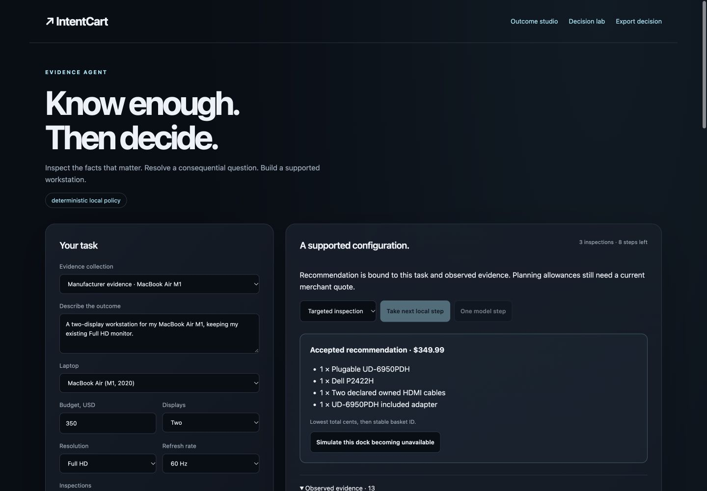

<div align="center">

# IntentCart

### Before you buy the parts, know whether the whole thing works.

Evidence-aware planning · Inspectable decisions · Explicit approval

[Start locally](#start-locally) · [How it works](#how-a-request-becomes-a-plan) · [Engineering evidence](#what-the-evidence-says) · [Explore the code](#inside-the-repository)

</div>



> **Publication status:** This repository currently contains the project overview and visual assets. The runnable application, tests and technical documents described below are complete locally and await source publication. Setup commands apply to that complete source checkout.

## It starts with a simple request

> “I have a laptop. I want two monitors, enough charging power and a setup within my budget. What do I actually need?”

A shopping cart can hold a dock, two displays and a pair of cables. It cannot tell you whether the laptop supports that arrangement, whether a driver is required, or whether one missing specification changes the answer.

IntentCart starts with the outcome. It turns reviewed requirements into a complete workstation plan, investigates the facts that matter, and explains what remains uncertain. When the request cannot be satisfied, it shows the conflict. When something changes, it looks for a repair that changes the fewest component slots.

Then comes a separate decision: whether to buy. A supported plan does not authorize a payment. You review an exact basket and total before PayPal sandbox checkout can proceed.

**The idea is simple: understand the system before committing to its parts.**

## How a request becomes a plan



1. **Describe the outcome.** Review the budget, displays, power and other supported requirements. The reviewed typed goal is authoritative.
2. **Investigate what matters.** Inspect missing specifications and distinguish known, unknown and conflicting facts.
3. **Explore a complete setup.** Compare compatible baskets in a 3D workspace. Inspect support, conflicts and possible repairs.
4. **Review the exact decision.** The quote binds the selected basket, prices and current state. Changes invalidate earlier approval.
5. **Approve sandbox checkout.** The payment path checks capture evidence and preserves retry identities when a response is uncertain.

The planner handles a declared finite catalog and constraint set. “Compatible” means supported under those represented rules and available evidence.

## A second workspace asks a different question

**What should an agent learn before it recommends anything?**

At `/agent`, a bounded evidence controller can **search, inspect, clarify, recommend or defer**. Every action passes the same validator. Unsupported basket IDs, stale revisions, mismatched product variants and repeated inspections are rejected.

The curated example connects an Apple MacBook Air M1, a specific Plugable dock revision and Dell monitor specifications. Each inspected field carries its value, unit, exact variant, source URL and review date. Cable capabilities and price allowances remain explicitly declared scenario assumptions. Manufacturer review is evidence to inspect; it is not a physical hardware test or a live merchant offer.



This workspace is separate from the fictional merchant catalog and **cannot create checkout**. Its default controller is a deterministic local policy. An optional language-model proposal path is implemented and gated, but live model execution has not been verified.

In the main Missions planner, explicit pairwise choices can also update a four-attribute Bayesian preference estimate. Hard constraints still apply, and a changed selection needs a fresh quote. Estimated preference does not establish true user utility or optimality.

## One project, several ways to inspect it

| Workspace | What you can do |
|---|---|
| `/missions` | Describe → Explore → Review; build a complete fixture setup in the cinematic 3D studio. |
| `/agent` | Inspect curated manufacturer evidence and step through bounded agent actions. |
| `/reliability` | Inspect decision claims, evidence-budget comparisons and saved failure traces. |
| `/learn` | Explore the original Bayesian pairwise preference-learning lab. |
| `/lab` | Rehearse fictional changes and inspect decision exports. |

The interface uses locally served Three.js and procedural hardware. Orbit, zoom, inspect parts and take a guided tour. Reduced-motion behavior and an illustrated fallback support the experience. Browser WebGL renders the scene; the planning and research core runs on CPU.

## Start locally

**Requirements:** Python 3.12 and a complete source checkout. Node.js is needed for JavaScript verification.

```sh
python3.12 -m venv .venv
source .venv/bin/activate
python -m pip install -r requirements.lock.txt
# Create the private local configuration only if it does not exist.
test -f .env || cp .env.example .env
chmod 600 .env
python -m intentcart
```

Open **http://127.0.0.1:4000**. Start with an example in Missions, review its settings, build the setup and inspect any missing evidence.

**The local planning core needs no API key, rented GPU, card or paid service.** Keep `EXTERNAL_CALL_LIMIT=0` and optional model budgets at zero for local exploration. Use the exact configured origin; if you change ports, update `PUBLIC_URL` to match.

<details>
<summary>Windows setup</summary>

```powershell
py -3.12 -m venv .venv
.venv\Scripts\Activate.ps1
python -m pip install -r requirements.lock.txt
if (!(Test-Path .env)) { Copy-Item .env.example .env }
python -m intentcart
```

Protect `.env` using local file permissions. No credentials are required for the local planning experience.

</details>

## What the evidence says

These results are **dated local checks**, not live CI badges or claims about real customers.

| Question | Observed result | Scope |
|---|---|---|
| Does fixture planning match an independent oracle? | **73/73** solvable minimum-cost plans; **311/311** infeasible goals deferred. | 384 authored synthetic goals, three controllers, 1,152 runs. |
| Can targeted inspection avoid irrelevant lookups? | **143** inspections versus **1,920** for a full census. | The same finite fixture catalog; not measured model cost savings. |
| Does repair preserve the declared objective? | **272/272** repair outcomes match the independent oracle. | 241 feasible repairs and 31 infeasible outcomes. |
| Can payment failures be reproduced and reduced? | **11** scenarios, **three** deliberately introduced defects, **28** reduction candidates. | Local API replays, an independent fake-provider ledger and simulated interruption boundaries. |
| Does a targeted agent policy use fewer inspections locally? | **121** inspections versus **280**; 19 versus 17 supported recommendations; zero invalid recommendations for either policy. | 12 authored structures × five budgets × two local policies = 120 correlated runs; not an LLM comparison. |
| Does the local verification suite pass? | **230 Python tests, 24 JavaScript behavior tests, nine syntax checks.** | Verified October 14, 2026 on this machine; remote CI and outside reproduction remain pending. |

**The negative findings matter too.** A CPU ridge-imitation policy lost to the practical decision-splitting baseline on the structural-shift experiment and remains research-only. The earlier preference controller also did not improve pooled held-out quality. Those outcomes are retained instead of presented as wins.

See evaluation methods and limitations (`docs/EVALUATION.md`, with source release), Missions and the independent oracle (`docs/MISSIONS.md`, with source release), adaptive acquisition (`docs/ACQUISITION.md`, with source release) and failure replay (`docs/REPLAY.md`, with source release). The fixture planner contains 17 fictional components and three fictional laptop profiles. No real-world compatibility or purchase-success rate follows from these tests.

## Reproduce the checks

With the Python environment active and Node.js installed:

```sh
python scripts/verify.py
python scripts/evaluate_missions.py --output /tmp/intentcart-missions.json
python scripts/evaluate_acquisition.py --check
python scripts/evaluate_agent.py --output /tmp/intentcart-agent.json
python scripts/evaluate_learned_acquisition.py --output /tmp/intentcart-learning.json
```

The canonical verifier uses disposable storage, blank provider credentials and a zero external-call ceiling. Read the experiment documentation before interpreting results; budgets, repeated task variants and shared catalogs affect the denominators.

## PayPal sandbox, when you are ready

Planning and quote review work without payment credentials. To exercise actual sandbox transactions:

1. Create or select a **sandbox** REST app in the [PayPal Developer Dashboard](https://developer.paypal.com/dashboard/applications/sandbox).
2. Store its client ID and secret in your private `.env`; run `python scripts/check_setup.py` and restart the server.
3. Use a separate Personal sandbox buyer account with test funds.
4. Review a plan, generate its exact quote and explicitly approve the USD total before checkout.
5. Inspect the saved receipt. After an uncertain capture, reconcile the saved order before retrying. Refund only a verified sandbox capture.

A historical backpack sandbox capture and full refund were verified on October 7, 2026. A new complete-workstation sandbox capture/refund remains unverified. The UI does not substitute a fake-provider result for an actual PayPal receipt.

## Inside the repository

```text
intentcart/
  app.py                     FastAPI application and owned API routes
  missions.py                Finite planning, evidence and minimal-change repair
  agent.py                   Bounded evidence tools and action validation
  evidence_catalog.py        Curated fields, sources and exact product variants
  workspace_preferences.py   Bayesian estimates over valid configurations
  validity.py                Separate feasibility, optimality and consent claims
  acquisition.py             Finite adaptive evidence-acquisition research
  replay.py                  Reproducible fault traces and failure reduction
  web/                       Local interface, state guards and 3D rendering
scripts/                     Verification, evaluation and packaging tools
tests/                       Python and JavaScript regression coverage
docs/                        Methods, architecture, evidence and limitations
submission/                  Demo assets and hackathon walkthroughs
```

| Read next | What it explains |
|---|---|
| Architecture (`docs/ARCHITECTURE.md`, with source release) | How the planner, evidence, storage and interface fit together. |
| Evidence agent (`docs/AGENT.md`, with source release) | Tool boundaries, source bindings, local comparisons and the learning experiment. |
| Decision validity (`docs/VALIDITY.md`, with source release) | What each decision claim establishes and what invalidates it. |
| Security and operations (`docs/SECURITY.md`, with source release) | Session ownership, exact approval, retry behavior and operational limits. |
| Interface design (`docs/DESIGN.md`, with source release) | The spatial studio, interaction model and accessibility behavior. |
| Demo walkthrough (`submission/DEMO_SCRIPT.md`, with source release) | A guided path through the project. |

`demandweave/` preserves an earlier experiment and is distinct from IntentCart.

## Boundaries worth understanding

This is a **single-instance sandbox application**. It does not include account authentication, distributed coordination, webhook settlement, live inventory or fulfillment. Source fingerprints identify content and detect changes; they are not authenticity signatures. Local tests do not establish a production security certification.

Optional Channel3 discovery is separate from fixture checkout. Optional inference requires explicit configuration and reviewed budgets. No live language-model trajectory, human-study outcome or public benchmark leadership is claimed. Keep credentials, raw feedback, private exports and runtime databases out of Git.

Built for the **2026 PayPal AI Hackathon**. Released under the [MIT License](LICENSE); bundled third-party notices remain with their components.
