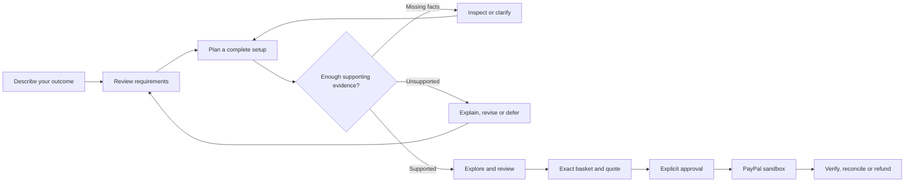

<div align="center">

# IntentCart

### Before you buy the parts, know whether the whole thing works.

Evidence-aware planning · Interactive 3D · Explicit approval

[Run locally](#run-locally) · [Explore](#explore-the-workspaces) · [How it works](#from-a-request-to-a-reviewed-decision)

</div>

## A cart holds products. A plan makes them work together.

> “I have a laptop. I want two monitors, enough charging power and a setup within my budget. What do I actually need?”

The dock looks right. The monitors fit the budget. The cables are in the cart. But can the laptop drive both displays? Is a driver required? Does the power supply deliver enough charging power?

IntentCart starts with the outcome. Review your requirements, explore a complete workstation in a cinematic 3D studio, and inspect the evidence behind each decision. Missing information stays visible. An impossible request gets an explanation. When availability changes, the planner looks for a repair that changes the fewest component slots.

Payment is a separate decision. A supported plan never grants permission to spend: an exact basket, current quote and explicit approval precede PayPal **sandbox** checkout.

## From a request to a reviewed decision



The application keeps these boundaries explicit:

- **Requirements before recommendations.** A bounded text interpreter proposes settings for review; typed requirements remain authoritative.
- **Evidence before support.** Known, unknown and conflicting facts are distinct. Source dates, exact variants, prices and permissions matter.
- **Preferences within constraints.** Pairwise choices update a Bayesian estimate without weakening hard requirements.
- **Approval for one exact decision.** Changed plans invalidate old quotes. Payment retries preserve operation identities, and uncertain results require reconciliation.

## Run locally

**Requires Python 3.12.** No Node.js build, API key, paid service or rented GPU is needed for the local application.

```sh
git clone https://github.com/usmanmohammed2306/IntentCart.git
cd IntentCart
python3.12 -m venv .venv
source .venv/bin/activate
python -m pip install -r requirements.txt
python -m intentcart
```

Open **http://127.0.0.1:4000**. Choose an example, review its settings and build a setup. Local SQLite storage is created automatically in `var/`.

On Windows, create the environment with `py -3.12 -m venv .venv`, activate it with `.venv\Scripts\Activate.ps1`, then run the same install and start commands.

To check a running server:

```sh
curl http://127.0.0.1:4000/healthz
```

Expected response: `{"status":"ok","environment":"sandbox"}`.

## Explore the workspaces

| Address | Experience |
|---|---|
| `/` or `/missions` | Describe → Explore → Review. Inspect parts, orbit the 3D setup and repair fictional-catalog plans. |
| `/agent` | Step through a bounded evidence controller: search, inspect, clarify, recommend or defer. |
| `/workbench` | Review manufacturer records, exact variants, owned inventory, source expiry, all-in costs and preference history; export the decision. |
| `/research` | Explore saved finite-budget comparisons, CPU learning curves, ablations and preference diagnostics. |
| `/reliability` | Inspect separate decision claims, evidence-budget comparisons and recorded fake-provider failure traces. |
| `/learn` and `/lab` | Explore Bayesian pairwise learning and rehearse fictional budget, shipping or stock changes. |
| `/study` | Open the optional consent-based local pilot instrument. No conducted human study is claimed. |

The workbench preserves unsaved requirement edits in tab memory when another tab changes the task. Compare your edits with the latest saved values, restore only your changed fields, then explicitly review and apply them. Nothing is automatically resubmitted or saved to browser storage.

Before accepting a source replacement, compare its current and proposed values, units, URL and review date. Changed metadata is highlighted, and confirmation is bound to the displayed proposal and task revision. Refreshing, changing the proposal or editing its form clears that confirmation; acceptance never replaces a fresh inspection. You can withdraw a mistaken pending proposal without changing accepted evidence or preference answers. The exact proposal ID and task revision prevent an older tab from withdrawing a newer proposal.

The **Trade-off lens** compares two currently supported setups from the same revision: all-in price difference, exact component/quantity changes, estimated preference contributions and inspected source fields. Download a readable comparison without changing the task, selecting a basket or granting checkout approval. Refreshing or changing the choices clears the old comparison.

The evidence workspace uses curated manufacturer records and declared scenario assumptions. It cannot create checkout. Missions uses a separate fictional merchant catalog. Browser WebGL renders the locally served Three.js scene, with an illustrated fallback; the planning core runs on CPU.

## Optional configuration

The application reads a private `.env` from the repository root. It is ignored by Git. The defaults run locally with external inference and discovery disabled:

```dotenv
PUBLIC_URL=http://127.0.0.1:4000
DATABASE_PATH=var/intentcart.sqlite3
EXTERNAL_CALL_LIMIT=0
ASTRO_BUDGET_MICROUSD=0
```

If you change the port, set `PORT` in the shell before starting and make `PUBLIC_URL` match the exact browser origin. Keep the server bound to localhost for local use.

**PayPal sandbox:** create a sandbox REST application in the [PayPal Developer Dashboard](https://developer.paypal.com/dashboard/applications/sandbox), set `PAYPAL_CLIENT_ID` and `PAYPAL_CLIENT_SECRET` privately, restart the server and use a separate Personal sandbox buyer. Review and approve the exact quote before opening checkout. No real funds or goods are involved. After an uncertain capture, reconcile the existing order before retrying.

**Optional hosted inference:** the Astropods adapter requires `ASTRO_GATEWAY_URL`, `ASTRO_GATEWAY_API_KEY`, `MODEL_DEFAULT`, explicitly reviewed input/output rates, `ASTRO_CREDIT_ONLY_CONFIRMED=true`, and positive call and cost ceilings. Costs are configured in micro-USD; the rate variables are `ASTRO_INPUT_MICROUSD_PER_MILLION` and `ASTRO_OUTPUT_MICROUSD_PER_MILLION`. Keep ceilings at zero unless you deliberately authorize usage. Hosted inference is separate from the default deterministic controller.

**Optional discovery:** `CHANNEL3_API_KEY` and an explicitly positive `EXTERNAL_CALL_LIMIT` enable separate product discovery. Discovery listings do not authorize checkout or establish compatibility.

## Inside the runnable source

```text
intentcart/
  app.py, *_routes.py         HTTP routes, session ownership and persisted state
  missions.py                Finite planning, investigation and minimal-change repair
  agent.py, workbench.py      Bounded actions and human evidence review
  evidence_catalog.py        Curated sources and exact product variants
  learning.py                Bayesian preference learning
  workspace_preferences.py   Preferences over supported configurations
  acquisition.py             Finite evidence-acquisition reference
  finite_budget.py            CPU budget and learning diagnostics
  validity.py, research.py    Decision claims and source-checked saved results
  replay.py                  Local failure reproduction with a fake provider
  paypal.py, gateway.py      Optional bounded external transports
  data/                      Catalogs, settings and results used by the interface
  web/                       HTML, CSS, JavaScript, illustrations and Three.js
scripts/                     Sources required to validate the saved research views
docs/protocols/              Two machine-readable inputs for those views
requirements.txt             Pinned runtime dependencies
```

The research views check saved results against their source hashes. Their supporting scripts and JSON protocols are retained so those checks remain usable. To regenerate a report locally, for example:

```sh
python scripts/evaluate_missions.py --output /tmp/intentcart-missions.json
```

## Scope and limits

IntentCart is a **single-instance sandbox application** built for the 2026 PayPal AI Hackathon. Compatibility means support under the represented finite rules and available evidence; it is not physical hardware certification or a live retailer guarantee. Saved synthetic experiments, CPU learning diagnostics and fake-provider replays are distinct from human studies and live transactions. Negative learning results remain visible in the application.

The local planning experience works without external services. Actual inference, discovery and sandbox payments require your own deliberate configuration. The project does not include account authentication, distributed settlement, live inventory, fulfillment or production security certification. Source fingerprints detect content changes; they are not authenticity signatures.

Released under the [MIT License](LICENSE). Bundled Three.js retains its [upstream notice](intentcart/web/vendor/THREE_LICENSE.md).

## Decision Studio

Open **Planning workbench → Decision Studio** after the evidence agent has returned supported configurations. Explore the decision without changing it: all analyses run locally in the browser, over at most the twelve returned options in the loaded revision. They do not search the full catalog, fetch sources, predict actual prices or grant checkout authority. Refresh the task to obtain a newer revision; results are discarded when the loaded task changes.

<details>
<summary>Available planning tools</summary>

- **Budget coverage staircase** — See which returned setups remain affordable at each budget step; no plan is recomputed.
- **Tax and shipping allowance** — Find the maximum combined extra costs each supported basket can absorb within your hypothetical budget.
- **Component spend exposure** — Identify which component categories account for the largest share of one complete basket.
- **Single-product outage recovery** — Find the least disruptive returned fallback when one exact product is unavailable.
- **Correlated stock-out stress** — Remove up to four products together and inspect surviving complete baskets.
- **Dock dependency resilience matrix** — Stress every represented dock independently and see the fallback cost for your starting setup.
- **Diversified three-setup shortlist** — Choose three returned options that maximize their minimum component-slot distance, then minimize combined price.
- **Least-change replacement graph** — Map the closest supported alternatives by changed component slots, with exact transition cost.
- **Least-disruption budget ladder** — For each affordable price breakpoint, find the option with the fewest changed slots relative to your current choice.
- **Per-product price-rise tolerance** — Calculate how much each product unit price can rise before every containing returned basket exceeds your budget.
- **Uniform hardware inflation stress** — Apply a user-declared percentage price increase to component subtotals while keeping saved tax/shipping fixed.
- **Exact-product price shock** — Change one component unit price hypothetically, respecting the quantity in each supported basket.
- **Tax and shipping scenario estimator** — Replace saved extras with a declared tax rate on hardware and a fixed shipping amount.
- **Declared operating-cost horizon** — Compare purchase plus explicitly assumed electricity and maintenance costs over a chosen horizon; no device consumption is inferred.
- **Cost per productive session** — Translate one-time planning costs into a stated number of work sessions without implying financing or resale value.
- **Worst-case price interval screen** — Screen setups against a declared component-price uncertainty band; saved extras remain fixed.
- **Price-scenario minimax regret** — Find the smallest worst-case excess cost across baseline, hardware-inflation and one-product-shock scenarios among returned options.
- **Cost and model-trade-off Pareto frontier** — Identify returned setups dominated on total price, changed slots and the three estimated non-price contributions.
- **Exact-component shortlist locks** — Filter supported alternatives while keeping up to four explicitly selected components.
- **Preference-contribution reweighting sandbox** — Explore user-supplied multipliers over the current model contribution estimates; no learned preference is changed.
- **Preference sensitivity sweep** — Count which options lead on a fixed 35-profile multiplier grid, retaining exact ties rather than inventing probabilities.
- **Preference cycle audit** — Detect directed cycles in the last 48 retained explicit A/B answers, with ties and skips kept separate.
- **Distinctive comparison pair finder** — Surface supported pairs absent from the last 48 retained comparisons with large differences in model-contribution vectors.
- **Source review expiry forecast** — Forecast review deadlines from observed dates and the declared review interval, separating undated/fictional fields.
- **Observed-source dependency blast radius** — Map each inspected product field to returned baskets containing that exact product.
- **Source origin concentration audit** — Group observed fields by cited URL origin and evidence kind; do not confuse repeated fields with independent sources.
- **Observed-value contradiction audit** — Find distinct values observed for the same exact product and field without resolving the contradiction automatically.
- **Evidence review priority queue** — Order inspected fields by overdue/unknown age and number of exposed returned setups.
- **Portable private-data-minimized decision snapshot** — Export supported plans, product declarations and observed fields without query text, sessions or raw event history.
- **Earlier-versus-current decision snapshot diff** — Paste an exported studio snapshot to compare prices, available setup IDs, observed values and source identities without importing authority.

</details>

Each result can be downloaded as JSON. Review product and source content before sharing. Price scenarios use integer cents with explicit rounding; operating costs use your declared assumptions. Preference contributions describe a finite model, not measured hardware performance or personal satisfaction. None of these tools updates the basket, requirements, evidence, preference history or payment approval.
