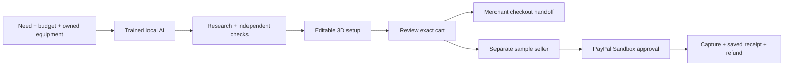

<div align="center">
  
  <h1>IntentCart</h1>
  <p><strong>Buy the missing pieces. Make the whole setup work.</strong></p>
  <p><a href="#run-locally">Run locally</a> · <a href="#one-workspace-from-need-to-review">The experience</a> · <a href="#paypal--ai">PayPal + AI</a> · <a href="#the-trained-agent">Training</a></p>
</div>

Monday morning. A new teammate arrives with a laptop. There is a spare monitor in storage, three possible docks online, and a cable nobody can identify. The budget is fixed. Everything needs to work together.

**IntentCart turns that buying problem into one visual workspace.** Start with what you own, describe what you need, and work with a trained local AI to research exact models, check the connection path, arrange the desk and review the missing purchases.

It is built for small IT teams, managed-service providers and office managers. The useful record is more than an answer in a chat: equipment, sources, quantities, inventory reservations and approvals stay connected to the saved setup.

## One workspace, from need to review

| Start with… | IntentCart helps you… |
|---|---|
| Your laptop, desk and budget | Build and edit a 3D workspace; drag, rotate, resize, undo and save |
| An exact product name | Research official sources and review the proposed model |
| Existing equipment | Separate **Use mine** from **Buy new**, so reused items stay out of the cart |
| An uncertain setup | Check recorded display, connection, power and space requirements; preview changes and verified placement repairs |
| A purchasing decision | Review quantities, available merchant prices and delivery estimates, then open the exact store cart |
| A team request | Reserve tagged inventory, require a separate approver, and track receiving and returns |

Guest editing works immediately. Sign in to save work and use the local AI. One assistant stays beside the workspace; details open when needed.



## Run locally

Use **Python 3.12**, a modern browser and a working C/C++ toolchain. Initial model setup downloads about 1.5 GB and temporarily needs more RAM than inference. Serving runs on CPU; no paid model key or cloud account is required.

```sh
git clone https://github.com/usmanmohammed2306/IntentCart.git
cd IntentCart
python3.12 -m venv .venv
source .venv/bin/activate
python scripts/install_runtime.py
python scripts/setup_trained_model.py
EXTERNAL_CALL_LIMIT=0 INTENTCART_AUTH=accounts python -m intentcart
```

Open **http://127.0.0.1:4000/agent**. Create your own account and keep the recovery key private. Data is stored in `var/`; use one application worker. Health check: `curl http://127.0.0.1:4000/healthz`.

On Windows, use `py -3.12 -m venv .venv`, activate `.venv\Scripts\Activate.ps1`, and set environment variables using PowerShell syntax before starting Python.

<details>
<summary><strong>Merchant prices, tax and shipping</strong></summary>

Supported Plugable and Satechi connectors refresh exact variants and observed availability. **Get delivery total** requests available shipping, automatic discounts and estimated tax for the selected destination. Missing charges stay unresolved. Changes to quantities or destination invalidate the old estimate; quotes expire after at most 15 minutes.

For the anonymous Satechi browser check, install the pinned browser once:

```sh
python -m playwright install chromium
```

Linux hosts may require `python -m playwright install --with-deps chromium`. Configure `INTENTCART_UCP_PROFILE_URL` with your own publicly accessible HTTPS agent profile, served by the app at `/.well-known/ucp`. For local verification only, the documented tutorial identity can be explicitly selected:

```sh
INTENTCART_UCP_PROFILE_URL=https://shopify.dev/ucp/agent-profiles/examples/2026-08-25/valid-with-capabilities.json INTENTCART_UCP_TUTORIAL=true EXTERNAL_CALL_LIMIT=0 INTENTCART_AUTH=accounts python -m intentcart
```

The tutorial identity is rejected outside local mode. Street/city input is transient and requires consent naming the stores. Browser checks use an isolated anonymous session, revalidate visible charges against merchant responses, cancel temporary estimate checkouts and never enter payment fields. Rate limits stop requests without automatic retries.

An actual two-store check on **October 28, 2026, at 10:03 p.m. Phoenix** reconciled **$482.87 − $5.99 savings + $42.55 estimated tax + $0 shipping = $519.43**. Saving/reopening and stale-basket guards were verified; temporary checkouts were canceled. This is a dated estimate, not a current offer or completed purchase. Coverage depends on merchant and destination; final charges are confirmed at the store.

</details>

<details>
<summary><strong>Document retrieval and deployment</strong></summary>

Optional document/research tools use a separate local retrieval encoder:

```sh
python scripts/setup_encoder.py --directory var/encoder
INTENTCART_EMBEDDING_DIR=var/encoder EXTERNAL_CALL_LIMIT=0 INTENTCART_AUTH=accounts python -m intentcart
```

`Dockerfile` and `compose.yaml` provide the local container route; `Dockerfile.astropods` and `astropods.yml` retain the sponsor-hosting configuration. Configure durable storage, HTTPS, account access and a real public merchant profile for a hosted installation. Hosting and third-party services retain their own limits and terms; local startup does not provision them.

</details>

## PayPal + AI

**Cart → PayPal Sandbox** demonstrates a complete, controlled sample-seller transaction. The trained agent searches and inspects a fictional catalog, then proposes a checked cart. A human reviews the exact expiring quote before the PayPal JavaScript SDK opens buyer approval. Orders v2 handles creation, capture, status reconciliation and full refund; durable request identities and allocation counters protect retries.

The sample cart is **$229 in test funds**: dock $89, monitor $99, cables $12 and power supply $29. It is separate from real merchant goods; IntentCart does not resell those products. Historical actual sandbox capture/refund runs were verified. A new transaction requires your own sandbox app and a new deliberate test allocation.

<details>
<summary><strong>Connect your free PayPal Sandbox</strong></summary>

Create a REST app in the [PayPal sandbox dashboard](https://developer.paypal.com/dashboard/applications/sandbox). Store these values only in your private environment or ignored `.env`:

```dotenv
PAYPAL_CLIENT_ID=your_sandbox_client_id
PAYPAL_CLIENT_SECRET=your_sandbox_client_secret
PAYPAL_TEST_ALLOCATION_ID=your_unique_test_identifier
PAYPAL_TEST_CALL_LIMIT=12
PAYPAL_TEST_AMOUNT_CENTS=22900
PAYPAL_TEST_EXPIRES=your_fixed_unix_expiry
```

Generate the expiry once with `python -c "import time; print(int(time.time()) + 3600)"`. Preserve the same allocation values across restarts; do not regenerate them on every launch. OAuth and server API calls reserve slots before dispatch, and verified full refund closes the allocation. Use a separate sandbox personal buyer account. The app supports sandbox endpoints only.

`EXTERNAL_CALL_LIMIT=0` controls sponsor-model calls, not the separate sandbox counter. Planning works without payment credentials. Never commit credentials, use a real card or share account passwords.

</details>

## The trained agent

The required controller is a task-specific **Qwen3-0.6B LoRA**, with **1,146,880 trainable parameters**, served locally through **llama.cpp Q8 on CPU**. LangGraph coordinates bounded tool use; typed checks independently validate proposals. Research, model replacement, software consent and payment approval remain distinct actions.

The adapter, manifests, synthetic dataset partitions, training scripts and TPU notebook are included. Setup verifies the pinned base revision, adapter and serving-artifact hashes. A small trained intent router is included alongside the generative controller.

<details>
<summary><strong>Training and evaluation details</strong></summary>

Initial completion-only LoRA training used 915 authored synthetic examples and 360 optimizer steps on a free Colab v5e-1 TPU. The current TRL/PEFT continuation completed 128 steps / 512 presentations from a 704-example partition on Apple MPS. No new training is needed to run the shipped adapter.

A related uncached CPU Q8 policy diagnostic matched **105/107** prompts versus **58/107** for the parent adapter; both matched **59/59** original permission-policy targets. However, **103/107** test prompts share an exact observed finite state with training. These are related synthetic policy/format results, not unseen-state reasoning or measured user benefit. Two Q8 errors remain. The adapter model card and manifests retain the narrower initial results and dataset details.

Current release checks include **1,044 selected Python cases**, **124 JavaScript checks**, separate rollout-preservation tests and actual live merchant/UI verification. Historical 100,000 composed API journeys are synthetic diagnostics, not people or a current full-product rerun. Independent user studies and physical hardware certification remain unperformed.

</details>

## Built with

| Technology | Role |
|---|---|
| Python, FastAPI, Pydantic, SQLite | Accounts, strict contracts, saved work, approvals and durable budgets |
| Qwen, PyTorch, Transformers, PEFT, TRL, llama.cpp | Trained local controller and CPU serving |
| LangGraph | Bounded research, planning and repair workflows |
| Three.js, Anime.js | Procedural interactive 3D scene and transitions |
| PayPal Orders v2, JavaScript SDK | Sandbox approval, capture, reconciliation and refund |
| Playwright, merchant commerce APIs | Anonymous source/checkout reconciliation where supported |
| Astropods | Sponsor-native hosting and historical model inference |

Optional evidence tools include document retrieval, an OpenAI-compatible SDK transport and read-only MCP. Channel3 was used for earlier discovery; redeemed Render credit is not a claim of Render hosting.

## Project structure

```text
intentcart/        Application, planning, research, accounts and payment boundaries
  web/            Single-page 3D workspace, graphics and supporting views
  data/           Product evidence, trained adapter/router and saved diagnostics
scripts/          Runtime/model setup and required report generators
training/         Reproducible authored data and training code
docs/protocols/   Machine-readable evaluation contracts
```

The team-subscription opportunity is repeat onboarding, shared inventory and approvals. Revenue, customer demand and time savings are hypotheses, not measured outcomes. Arbitrary product names can be researched, but ambiguous specifications and unavailable sources remain unresolved; illustrative geometry is not certified physical fit.

## License

Project source is [MIT licensed](LICENSE). Bundled Three.js, Anime.js, Qwen-derived artifacts and llama.cpp retain their upstream licenses/notices. Product names identify sources and do not imply endorsement.
