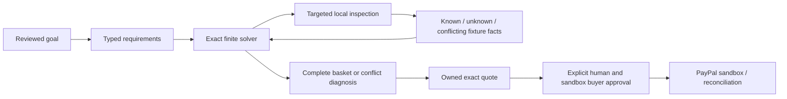
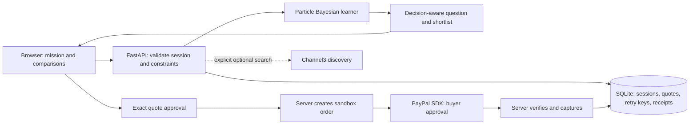

# 4.3 workbench and finite-budget research

`workbench.py` is a pure extension over owned agent state. It holds a per-task reviewed catalog snapshot, requirements, offers, source proposals and preference history. A mutation binds the exact revision, clears acceptance and records a bounded before/after diff; structural edits clear old preference evidence. Source replacement is proposed against a source digest, accepted against the exact proposal, and removes that source from inspected observations. Other current sources may independently support the field. The base compiler identity and effective catalog fingerprint remain distinct.

`workbench_routes.py` supplies human-only routes, owned exports and bounded, non-mutating counterfactual/cost previews. The model action schema does not contain these human edit operations. `/workbench` uses text-safe DOM rendering, existing exact-origin/CSRF/session checks and source-bound status. Unknown tax/shipping, expired reviewed evidence and missing requested capability facts fail closed. Extended three/four-display and USB-C configurations are bounded prototypes, positively checked on synthetic declarations; represented manufacturer data remains the smaller reviewed scenario. No curated task creates a quote or payment.

`finite_budget.py` adds an exact rational finite-horizon reference and an eight-feature CPU ridge diagnostic. The objective differs from the existing unrestricted-cost teacher. Frozen protocols describe 12 training/12 test structures, prior/cost shifts, four budget cuts, learning curves and teacher/feature ablations. `/research` reads saved hash-bound reports and cannot start those experiments. Transcript import preserves unknown billing and imported-evidence provenance. Optional Channel3 export review is no-network and cannot import compatibility facts. No scheduled provider usage is introduced.

# 4.2 evidence workspace additions

`agent.py` is a pure bounded controller/tool validator; `agent_routes.py` supplies owned, CSRF/origin/revision-checked routes. `evidence_catalog.py` binds curated source fields; the real collection stays independent of fictional merchant checkout. `workspace_preferences.py` ranks already-valid baskets. Missions comparisons reuse it, clear prior approval through revision/version changes, recompute canonical quotes and label preference optimality unresolved. Agent model responses are dispatched outside the storage lock after durable reservations, then checked against the current revision before application. The single-worker and sandbox limitations below remain.

`learned_acquisition.py` is a separate CPU ridge-imitation experiment; its negative practical-baseline result prevents promotion. `research.py` exposes new source-bound saved agent/learned reports. Private publication scheduling/operator tools are excluded from this public source export. No scheduled resource use is authorized.

# Missions 4.1 architecture

## Decision validity and reproducible research

`validity.py` analyzes immutable catalog/goal/evidence snapshots. Candidate checks cache dependency digests; changes selectively reevaluate affected rows before reranking. Semantic claims are paired with full recomputation. The server persists the bounded cache; `missions.public_record` strips it and internal dependency fingerprints from HTTP responses, quote snapshots and exports. Displayed certificate hashes are content identities, not signatures or payment authority. Every mission mutation still increments the existing revision/version. The independent spending gate remains authoritative.

`acquisition.py` is a separate pure finite-world library. Exact rational dynamic programming selects an adaptive query tree under an explicit prior. Practical decision-splitting and information-per-cost policies, evidence-reuse/restart ablation and a census baseline share a consensus stopping rule. `evaluate_acquisition.py` creates hypotheses from the independently implemented Missions oracle; the simulator alone receives the selected truth world. Bounds reject oversized problems. Declared structural checks and budget curves are exposed in `/reliability`; this does not add a live model or replace ordinary mission inspection.

`replay.py` launches fresh local interpreters with disposable SQLite application storage and a second fake-provider ledger. A strict action allowlist drives actual API endpoints, known interruption schedules and three test-only mutants. Source and normalized outcome digests make exported traces replayable; bounded single-event deletion reduces failures while preserving prerequisites. No mutation switch is available over HTTP. `research.py` requires the complete per-artifact source manifest and expected schema before serving saved evidence. Default responses omit raw row collections; `full=true` returns full public fixture records.

The new Decision lab is locally served HTML/CSS/JavaScript, with no external resources. Page interactions read existing results or step through saved events. CLI runners generate new offline results explicitly. No background jobs, model calls or provider operations run on page load. Operational single-worker/payment-network lock limits below remain unchanged.

`missions.py` compiles reviewed typed goals, resolves three-valued fixture facts and enumerates complete baskets. Initial planning/inspection minimizes price; inventory/requirement repair minimizes changed slots then price. Missing/conflicting facts fail closed. A deletion algorithm explains subset-minimal infeasibility in the finite universe. `gateway.py` is an optional bounded Astropods structured-goal adapter; it cannot supply facts or consent. `scripts/missions_oracle.py` is an independent implementation used by `evaluate_missions.py`.

Owned outcome records reside under the existing session's `outcome` key, with revision and source identity. Mutations increment global session version and invalidate old quotes. Source changes require a new compilation while old records remain privately exportable. `/api/missions/quotes` recomputes the plan; `spending_gate` dispatches bundle quotes to complete-structure, exact-price, evidence, source, version, expiry and consent checks. Existing PayPal retries/reconciliation remain shared. `/learn` preserves the original product. See MISSIONS.md for precise assumptions and limits.

## Outcome studio client

The main `/` and `/missions` client combines the existing `missions.js` controller and `missions-state.js` draft/quote guards with the procedural renderer in `spatial-scene.js`. The controller's **Describe → Explore → Review** state selects the editable brief, full-width workstation with a shared decision bar, or native exact-quote dialog; it is presentation state, separate from the owned mission revision and payment consent. Locally served Three.js 0.180.0, distributed under its retained MIT license, renders silver/titanium hardware on a grounded beveled platform through browser WebGL. The obsidian/slate interface uses ice cyan for interaction and restrained amber for review states. Device and platform geometry, detailed keys/ports/stands, original contour screen textures, contact shadows and the reflection environment are generated locally; no remote visual assets, model inference or sponsor API calls are required for the scene. The browser may use its graphics hardware for rendering. The backend planner and retained Bayesian learner execute on CPU; WebGL rendering is not GPU model training or inference.

The Setup / Evidence toggle adds a presentation-only lens over the same scene. `getSceneEvidence` derives conceptual, changed, verified, conflict or unresolved state from the current mission certificate and request guards. `validityCards` renders four separate compatibility, optimality, approval and execution claims; the latter two always preserve exact approval and saved-receipt boundaries. A dirty or unreviewed request supplies no current certificate to those cards and labels the rendered hardware as a prior plan or concept. The renderer receives only the bounded feasibility state for its evidence lighting; animations do not imply the other claims. The toggle and detailed-reasoning navigation neither invoke inference nor authorize provider operations.

The request-review gate compares the trimmed request with the last reviewed text. Changed wording disables Build and fresh-plan creation until local extraction or a reviewed proposal supplies settings; examples load explicit settings. The settings disclosure opens for correction before the separate compilation action, with review-field focus deferred until the busy task has re-enabled controls. Invalid controls reveal their ancestor disclosures and the Describe panel so native validation can focus them. This gate does not make the parser authoritative: the server receives the typed Goal, and its existing validation, source identity and finite solver remain responsible for plan acceptance. Draft goal/text differences continue to invalidate quotes and block evidence/repair actions until the plan is updated.

The pure `getGuideState` function chooses a next-action category from busy, unreviewed, new, dirty, evidence, conflict and complete-plan states. One decision bar renders that state, the actual compiled total and headroom, distinguishing a previous plan during draft edits. Its primary button calls an existing explicit review, compilation, fixture-inspection, conflict-navigation or quote handler. Desktop and mobile share the same markup and state mapping; on narrow layouts the bar becomes fixed near the viewport bottom. It supports missing-evidence and conflict states as well as complete plans. Guidance does not call a model, fabricate a reasoning trace or introduce an autonomous tool loop. The existing `canQuote` gate and server quote checks still apply, and the bar cannot authorize a payment. Closing the quote returns the workflow to Explore.

The initially closed native Plan details disclosure contains the connection path, check summary, optional savings action, component cards and setup/evidence/activity tabs. Conflict navigation and focused evidence navigation open it before scrolling or moving focus. Selected components use a dismissible contextual inspector over the scene. Entering Describe closes the inspector and tour; inspector close finds a visible focus target, and Escape restores focus to a menu summary when closing its focused contents. Disclosure, inspector and camera state remain local presentation state and do not write a mission revision.

The controller passes compiled display count, reuse state, selected component and draft status into the renderer. One-display plans show one centered monitor and its corresponding cable branch; two-display plans show both monitors. A changed draft does not replace the compiled scene before a new plan is accepted. Raycast selection, labeled component buttons and keyboard camera controls affect presentation only. `focusPart` supports component views and the manually advanced five-stop laptop/dock/display/cable/power tour without emitting a recursive selection callback. Tour entry disables automatic orbit; completion or close returns to the full perspective. Captions distinguish established plans from conceptual requirements, and a live region announces each stop. The primary scene controls expose the optional tour and part separation. View controls groups expanded layout, camera, motion and sound controls in a disclosure. Camera operations cannot change a mission revision, admit evidence, create a quote or authorize a payment. The server retains authority over plan facts, prices, ownership and spending gates.

The renderer caps pixel density at 1.5, requests a low-power graphics preference and suspends animation while hidden or outside its observed viewport. Reduced-motion preferences and the explicit motion toggle leave view controls usable without continuous animation. Sound starts off and uses local Web Audio only after opt-in. Lifecycle handlers dispose resources and rebuild the scene after a persisted page restore, restoring the controller's view toggles. Initialization failure or context loss exposes an SVG illustration and disables unavailable camera controls; the planning UI remains independent of graphics initialization. These are implementation properties, not measured rendering performance or universal browser-compatibility claims. [DESIGN.md](DESIGN.md) describes the interaction and accessibility boundaries.

## Retained preference-lab architecture

# IntentCart architecture

## Version 3 decision control and pilot

`decision.py` adds likelihood recency weighting and question-cost/expected-regret control. Mission `adaptive` defaults false; UI opt-in is explicit. Classic learning/parity stays unchanged. Adaptive ranking, weights, questions and quote snapshots use the same recency posterior. ASK requires gain above 0.002; RECOMMEND/DEFER use expected model regret 0.025 with four-answer/eight-attempt limits. These are uncalibrated illustrative utility, never payment approval. No-purchase retains the appropriate posterior. Rank-only rehearsal skips acquisition.

The source-bound two-stage stress runner uses disjoint development/test personas, reserved comparison pairs, nine policies/ablations and sensitivity. `/api/robustness` rejects source/development/config mismatch. Default mode stays classic because the primary held-out result is negative/inconclusive. `ROBUSTNESS.md` specifies inference and trade-offs; historical 2.2 timing binds its earlier source.

`study.py` and `/study` implement a separate five-arm pilot with private `studies` SQLite rows. Adult consent creates one random assignment per owned session. Blinded reserved pre/post answers never train the learner. Wrong survey answers remain outcomes. Records reject source-revision mixing; ownership/CSRF/version protect writes. Export/withdrawal stay available. Pilot never creates quotes/orders or changes the shopping mission. No automated retention purge, unique-human verification or human results. Read-only aggregation exports no IDs. See `HUMAN_STUDY.md`.

The retained preference lab uses a single-instance CPU backend with PayPal sandbox checkout. The current main spatial UI separately uses browser WebGL for graphics. IntentCart is a working hackathon build, not a live-money merchant deployment.

## Preference representation

The curated catalog contains 24 fictional backpacks. Each has seven normalized, illustrative attributes: lightness, weather protection, organization, capacity, comfort, style, and affordability. These are deliberately controlled demo inputs, not verified retailer specifications. Feature transformations live in the catalog generation specifications and the JSON values; weights and derived utilities are inspectable.

The learner holds 2,048 fixed Dirichlet(1.4) particles over nonnegative weights summing to one. A transparent keyword parser supplies a weak prior, `p(w) ∝ exp(2 w·intake)`. Choice likelihood is `sigmoid(12 × (u(A)−u(B)))`. Ties use a heuristic centered likelihood; skips have no statistical effect. We normalize in log space when replaying observations.

For each feasible, unused pair, the acquisition function is:

`P(A) max_x E[u(x)|A] + P(B) max_x E[u(x)|B] − max_x E[u(x)]`

This is one-step expected improvement of the Bayes decision, equivalent to expected reduction in Bayes utility regret under the model. It is exact for the finite particle approximation and binary likelihood, not globally optimal over four future questions. The tie likelihood is not included in acquisition; this is a known mismatch. No novelty claim is made for the statistical method. See [active preference learning research](https://arxiv.org/abs/2003.01899).

Hard constraints filter products before ranking and question selection. The budget includes shipping. Affordability is based on catalog item price; shipping is separately enforced in the hard constraint. Four non-skip answers or eight attempted comparisons stop questions; a single feasible item needs no comparison. The shopper can review any displayed feasible product at any time.

## State and consistency

SQLite initialization and receipt-preserving schema upgrades run in FastAPI's application lifespan at startup. Importing the module does not open storage. The isolated verification command blanks external credentials and supplies disposable storage before starting Python.

An opaque session cookie maps to a SHA-256 identifier in SQLite. The preference history is replayable. Every mission, answer, or simulated stock change increments a version. Comparisons bind to that version; repeated identical answers are idempotent, contradictory repeats fail. Quotes bind to a session, product, version, currency, exact amount, and expiration.

Payment provider IDs are never accepted from the client as authority. The backend looks them up using an owned quote. Persistent request keys and operation start times are committed before external side effects. Status polling cannot reset operation retry clocks. Reconciliation checks provider order reference, capture identity, currency, amount, and completed capture status; an order-level `COMPLETED` with a pending capture is not successful payment. A completed capture is reconciled even if preferences have subsequently changed; an actual payment must not be hidden by a stale local quote. Schema upgrades preserve existing receipts and conservatively block pending legacy retries with unknown start times.

All DB operations use a process lock and explicit transactions. This favors clear single-instance correctness over throughput. Network operations inside the lock serialize payment operations and can delay another session by up to the provider timeout. **Run one worker only.** Multi-instance deployment needs a shared transactional database, distributed locking, a background reconciliation worker, and revised operation leases.

## External boundaries

PayPal's API base is hard-coded to sandbox. OAuth secrets stay server-side; only the intended public client ID reaches the SDK. Channel3 is optional, explicitly invoked, and limited by a durable call counter. Discovery results cannot become sandbox catalog products or authoritative quotes. No provider browser automation or model API is required for the learner.

There is no webhook endpoint or unattended background settlement in this version. Status checks query PayPal directly. Disputes, taxes for real sales, real inventory, fulfillment, accounting, and live-mode onboarding are outside this sandbox build.

## Version 2: rehearsal and the action gate

`assurance.py` holds pure, deterministic world projection, total-price feasibility and proposal checks. A world is a deep copy of the current state with one declared intervention; it does not forecast a real retailer. `/api/rehearsal` computes four previews without saving. `/api/scenario` validates the owned version, persists the intervention and increments the version. Comparisons survive, including when the feasible set becomes empty. Scenario events are bounded to the latest eight.

`/api/proposals/check` and `/api/challenges` dry-run the same gate invoked before `/api/paypal/create`. The gate checks strict boolean approval, current quote/proposal version, expiry, owned product, exact integer cents, USD, current budget, availability/fit and current server pricing. Session ownership and CSRF/origin validation remain route boundaries. Neither dry-run route records approval or creates an order; an eligible control remains only a hypothetical proposal.

A quote freezes the mission, comparisons, posterior weights, hypothesis count, selected product, displayed alternatives and scenario context. `/api/decision-receipt/{quote_id}` enforces ownership and combines that snapshot with current checks and order status; `?download=true` supplies a JSON attachment. Consent is derived from a recorded checkout order, not hypothetical dry-run eligibility. SHA-256 identifies frozen content but is not a signature, tamper-proof ledger or truth guarantee.

`/api/lab-evidence` serves an explicitly fake-provider evaluation trace. It compares four current source hashes with the saved run and refuses stale evidence with HTTP 409. `scripts/evaluate_lab.py` regenerates the trace using disposable storage and actual API endpoints, with blank credentials and zero live calls. The Docker image includes that script so source checking also works inside the container. Replay is inspection of saved evidence, not a live outage injection.

## Mission Control client, 2.1

`web/insights.js` contains pure contribution, budget-envelope and preference-scale functions, covered by six native Node tests. `app.js` derives the constellation, decision lens and cockpit from current server state. The lens selection is local only and cannot change ranking, session version or payment authority. Rounded public weights explain an approximate utility margin; exact all-in prices remain separate. Command navigation and opt-in choice keys use existing application actions. The server remains authoritative for mission constraints, quotes, consent, provider operations and owned evidence.

## CPU execution, 2.2

Acquisition keeps one contiguous feasible matrix and evaluates binary likelihoods in batches of at most 64 pairs. `left = (w × P(A))ᵀ U`; `right = E[U] − left`, so a second branch matrix multiply is unnecessary. A sequential scan preserves candidate order and the prior 1e-12 tie tolerance. This changes execution, not the statistical policy. `compute(..., include_question=False)` supplies ranking-only data to rehearsal previews; normal mission/session flows retain question selection. Local timing/parity and the increased traced allocation are documented in `PERFORMANCE.md`.
